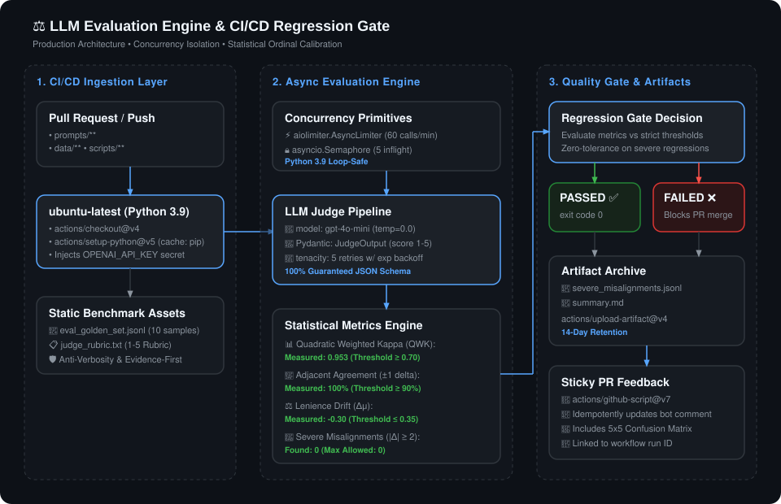

# ⚖️ LLM Evaluation Engine & CI/CD Regression Gate

A production-grade, latency-isolated LLM evaluation harness and automated CI/CD regression gate designed to enforce strict response quality, prevent model/prompt drift, and block regressions before deployment.

---

## 🏛️ System Architecture



<details>
<summary><b>🔍 View Mermaid Source Diagram</b></summary>

```mermaid
flowchart TD
    subgraph CI["GitHub Actions CI Gate (.github/workflows/eval-gate.yml)"]
        PR["Pull Request / Push\n(paths: prompts/**, data/**, scripts/**)"]
        Runner["ubuntu-latest (Python 3.9)"]
        PR --> Runner
    end

    subgraph Core["Evaluation Engine (scripts/eval_gate.py)"]
        Config["Golden Dataset\n(data/eval_golden_set.jsonl)"]
        Rubric["Judge Rubric\n(prompts/judge_rubric.txt)"]
        Limiter["AsyncLimiter (60 RPM)\n+ asyncio.Semaphore (5)"]
        
        Runner --> Config
        Runner --> Rubric
        Config & Rubric --> Limiter
        
        subgraph Judge["LLM Judge Pipeline"]
            OpenAI["OpenAI API (gpt-4o-mini)\nStructured Outputs"]
            Retry["Tenacity Exponential Backoff\n(RateLimit, Timeout, ConnectionError)"]
            Limiter --> Retry --> OpenAI
        end
        
        subgraph Metrics["Statistical Metrics Engine"]
            QWK["Quadratic Weighted Kappa (QWK >= 0.70)"]
            Adj["Adjacent Agreement (+-1 >= 90%)"]
            Drift["Lenience Drift (|Δμ| <= 0.35)"]
            Severe["Severe Slicing (|Δ| >= 2, Max 0)"]
            CM["5x5 Confusion Matrix"]
            OpenAI --> Metrics
            Metrics --> QWK & Adj & Drift & Severe & CM
        end
    end

    subgraph Outputs["Artifacts & Feedback"]
        Gate["Regression Gate Decision"]
        Metrics --> Gate
        
        Success["Exit Code 0 ✅ (Passed)"]
        Fail["Exit Code 1 ❌ (Blocks PR Merge)"]
        Gate -->|All Pass| Success
        Gate -->|Any Threshold Breached| Fail
        
        ArtSummary["artifacts/summary.md"]
        ArtSevere["artifacts/severe_misalignments.jsonl"]
        Gate --> ArtSummary & ArtSevere
        
        PRComment["Sticky PR Comment\n(actions/github-script@v7)"]
        StepSummary["GitHub Step Summary\n($GITHUB_STEP_SUMMARY)"]
        ArtSummary --> PRComment & StepSummary
    end

    classDef pass fill:#2ea44f,stroke:#22863a,color:#fff;
    classDef fail fill:#cf222e,stroke:#a40e26,color:#fff;
    classDef neutral fill:#0969da,stroke:#0550ae,color:#fff;
    class Success pass;
    class Fail fail;
    class QWK,Adj,Drift,Severe,CM neutral;
```

</details>

---

## 🚀 What We Have Built So Far

### Layer 1: Core Evaluation Harness
* **Judge Rubric (`prompts/judge_rubric.txt`)**: Calibrated rubric enforcing anti-verbosity mandates, surface-fluency decoupling (penalizing fluent hallucinations), and evidence-first reasoning on a 1–5 ordinal scale.
* **Golden Benchmark (`data/eval_golden_set.jsonl`)**: Seeded with 10 balanced reference test cases spanning factual grounding, constraint adherence, concise summaries, and hallucination stress tests.
* **Evaluation Runner (`scripts/eval_gate.py`)**:
  * High-concurrency async pipeline using `asyncio`, `aiolimiter`, and `tenacity`.
  * Python 3.9 event-loop safe primitives (`asyncio.Semaphore(5)` and `AsyncLimiter(60, 60)` initialized inside `main()`).
  * Structured Outputs via OpenAI (`gpt-4o-mini`) using Pydantic `JudgeOutput` schema (`chain_of_thought` + `score: int`).
  * Automated statistical metrics and regression checks against human baseline scores.

### Layer 2: CI/CD Regression Gate
* **GitHub Actions Workflow (`.github/workflows/eval-gate.yml`)**:
  * **Path Filtering**: Automatically triggers when modifications affect `prompts/**`, `data/**`, `scripts/**`, `tests/**`, `requirements.txt`, or the workflow itself.
  * **Artifact Upload**: Retains `artifacts/severe_misalignments.jsonl` and `artifacts/summary.md` on every workflow run with a 14-day retention policy.
  * **Sticky PR Comments**: Uses `actions/github-script@v7` to post or idempotently update a single summary comment per PR, preventing notification noise across iterative commits.
  * **Branch Protection Gate**: Fails the CI job with exit code `1` if any evaluation threshold is violated, blocking PR merges.

### Layer 3: Hybrid Routing & Open Weights
* **Multi-Backend Router (`scripts/router.py`)**: Abstracted judge interface supporting `OpenAIJudgeClient` (`gpt-4o-mini`) and `VLLMJudgeClient` targeting self-hosted open weights (e.g. Meta-Llama-3.1-8B-Instruct on RunPod Serverless or local vLLM).
* **Circuit Breaker & Fallback (`HybridJudgeRouter`)**: Automatically trips open after 3 consecutive primary failures, instantly routing evaluations to the secondary provider to protect throughput.
* **Telemetry & Latency Tracking**: Records per-sample latency and provider attribution in reports and artifacts.
* **Unit Test Suite (`tests/test_router.py`)**: 13 unit tests validating JSON parsers, clients, and circuit breaking.

---

## 🛠️ Technology Stack & Architectural Decisions

| Technology | Role | Why It Was Chosen |
| :--- | :--- | :--- |
| **Python 3.9+ Async** (`asyncio`) | Concurrent Engine | Non-blocking I/O allows dispatching batch judge calls concurrently without worker thread overhead. |
| **aiolimiter** | Rate Limiting | Enforces a strict 60 calls/minute sliding-window ceiling to prevent 429 RateLimitErrors from provider tier limits. |
| **tenacity** | Fault Tolerance | Configured with randomized exponential backoff (`wait_random_exponential(min=1, max=30)`) targeting retryable transient errors (`RateLimitError`, `APIConnectionError`, `APITimeoutError`, `InternalServerError`). |
| **OpenAI Structured Outputs** (`gpt-4o-mini`) | LLM Judge | Guarantees 100% adherence to the Pydantic schema (`chain_of_thought` reasoning + `score` integer 1–5) via grammar-constrained sampling, eliminating JSON formatting failures. Offers optimal cost-to-performance ratio for evaluation. |
| **Pydantic v2** | Output Validation | Type validation with strict numerical boundaries (`ge=1, le=5`). |
| **scikit-learn & NumPy** | Metric Calculation | Computes **Quadratic Weighted Kappa (QWK)** and confusion matrices. QWK is the industry gold standard for ordinal classification because it penalizes extreme misalignments (e.g., scoring 1 as 5) quadratically more than minor adjacent disagreements. |
| **GitHub Actions & `actions/github-script`** | CI Regression Gate | Zero third-party SaaS dependency. In-repo sticky PR comments provide developers immediate audit reports directly within code review workflows. |

---

## 📏 Quality Metrics & CI Gate Thresholds

| Metric | Target Threshold | Description & Rationale |
| :--- | :---: | :--- |
| **Quadratic Weighted Kappa (QWK)** | $\ge 0.70$ | Measures inter-rater agreement between the LLM judge and human experts above chance. Values above 0.70 represent high ordinal reliability. |
| **Adjacent Agreement ($\pm 1$)** | $\ge 90.0\%$ | Percentage of predictions where $\vert\text{LLM} - \text{Human}\vert \le 1$. Ensures reasonable boundary adherence for subjective nuance. |
| **Exact Match** | *Informational* | Strict match rate ($\vert\Delta\vert = 0$). Tracked for calibration without failing the gate. |
| **Lenience Drift ($\Delta\mu$)** | $\vert\Delta\mu\vert \le 0.35$ | Difference in mean scores ($\mu_{\text{LLM}} - \mu_{\text{Human}}$). Prevents systematic judge inflation (overly generous) or deflation (overly strict). |
| **Severe Errors ($\vert\Delta\vert \ge 2$)** | $\le 0$ | Hard zero-tolerance gate. Automatically fails the build if the judge awards a 4 or 5 to a human-scored 1 or 2 (or vice versa). Slices are dumped to `artifacts/severe_misalignments.jsonl`. |

---

## 💻 Local Setup & Execution

### Prerequisites
* Python 3.9 or higher
* OpenAI API Key with access to `gpt-4o-mini`

### 1. Clone & Set Up Virtual Environment

```bash
cd eval-engine

# Create virtual environment
python3 -m venv venv

# Activate virtual environment
source venv/bin/activate

# Install dependencies
pip install -r requirements.txt
```

### 2. Configure Environment Variable

You can either populate `.env.local` (recommended, git-ignored) or export directly:

```bash
# Option A: In .env.local
echo 'OPENAI_API_KEY=your-openai-api-key' >> .env.local

# Option B: Direct shell export
export OPENAI_API_KEY="your-openai-api-key"
```

### 3. Run the Evaluation Gate

```bash
python scripts/eval_gate.py
```

### Sample Output:

```text
2026-10-10 13:28:36 [INFO] Dispatching async evaluation for 10 test samples...
2026-10-10 13:28:39 [INFO] HTTP Request: POST https://api.openai.com/v1/chat/completions "HTTP/1.1 200 OK"
...

## ⚖️ LLM Judge CI Regression Gate

**Status:** `🟢 PASSED`

| Metric | Measured | Threshold | Result |
| :--- | :--- | :--- | :--- |
| **Quadratic Weighted Kappa (QWK)** | `0.953` | `>= 0.7` | ✅ |
| **Adjacent Agreement ($\pm 1$)** | `100.0%` | `>= 90.0%` | ✅ |
| **Exact Match** | `70.0%` | *Informational* | ℹ️ |
| **Lenience Drift ($\Delta\mu$)** | `-0.300` | `|$\Delta$| <= 0.35` | ✅ |
| **Severe Errors ($\vert{}\Delta\vert{} \ge 2$)** | `0` | `<= 0` | ✅ |

### Confusion Matrix (Rows: Human, Columns: LLM)
```text
[[3 0 0 0 0]
 [1 0 0 0 0]
 [0 1 0 0 0]
 [0 0 1 0 0]
 [0 0 0 0 4]]
```
```

---

## 📚 Project Documentation

Comprehensive architectural, product, and operational guides are maintained in the [`docs/`](docs/) directory:

| Document | Purpose | Key Content |
| :--- | :--- | :--- |
| **[PRD](docs/PRD.md)** | **Product Requirements** | Problem statement, statistical criteria, feature scope, and 5-layer roadmap. |
| **[TDD](docs/TDD.md)** | **Technical Design** | Concurrency primitives, Pydantic schemas, mathematical kappa formulation, and fault tolerance. |
| **[WORKFLOW](docs/WORKFLOW.md)** | **Developer & Operations Guide** | Local execution, dataset curation standards, CI/CD procedures, and the sync protocol. |
| **[SPRINT DASHBOARD](SPRINT_DASHBOARD.md)** | **Milestone Tracking** | Current progress status across Layers 1–5, deliverables, and verification dates. |

> **⚠️ Mandatory Documentation Sync Protocol:**  
> Whenever a new feature, model provider, or threshold adjustment is developed, the author **MUST** simultaneously update [docs/PRD.md](docs/PRD.md), [docs/TDD.md](docs/TDD.md), [docs/WORKFLOW.md](docs/WORKFLOW.md), [SPRINT_DASHBOARD.md](SPRINT_DASHBOARD.md), and [README.md](README.md).

---

## 📂 Repository Directory Structure

```text
eval-engine/
├── .github/
│   └── workflows/
│       └── eval-gate.yml          # GitHub Actions CI workflow (PR gating & sticky comments)
├── artifacts/
│   ├── severe_misalignments.jsonl # Exported severe error samples (|Δ| >= 2)
│   └── summary.md                 # Generated Markdown summary report
├── assets/
│   └── architecture_diagram.svg   # Vector architecture diagram for README
├── data/
│   └── eval_golden_set.jsonl      # Curated benchmark dataset with human labels
├── docs/
│   ├── PRD.md                     # Product Requirements Document
│   ├── TDD.md                     # Technical Design Document
│   └── WORKFLOW.md                # Developer Workflow & Sync Protocol
├── prompts/
│   └── judge_rubric.txt           # Prompt template and evaluation rubric
├── scripts/
│   ├── eval_gate.py               # Core async evaluation pipeline & regression gate
│   └── router.py                  # Multi-backend judge router (OpenAI, vLLM, Hybrid)
├── tests/
│   └── test_router.py             # Router unit tests & circuit breaker test suite
├── .env.local                     # Local secrets configuration (git-ignored)
├── .gitignore                     # Git ignore rules for virtualenvs, caches, secrets
├── LICENSE                        # MIT License
├── requirements.txt               # Pinned project dependencies
├── SPRINT_DASHBOARD.md            # Sprint milestone and layer tracker
└── README.md                      # Project documentation and architecture guide
```

---

## 🗺️ Roadmap & Next Layers

* **Layer 3: Hybrid Routing & Self-Hosted Open Weights** *(Completed)*:
  * Multi-provider router abstraction (`scripts/router.py`) supporting OpenAI and OpenAI-compatible vLLM endpoints.
  * Integration with self-hosted Llama 3.1 8B on RunPod Serverless with 3-failure circuit breaker tripping.
  * Unit test suite (`tests/test_router.py`) with 13 passing test cases.
* **Layer 4: Production Shadow Evaluation (Vercel)** *(Up Next)*:
  * Edge shadow evaluations via Vercel `waitUntil` / Next.js Edge runtime.
  * Latency-isolated production sampling (10% random traffic + high-uncertainty slices).
* **Layer 5: Continuous Calibration & Live Observability**:
  * Longitudinal drift monitoring dashboard.
  * Automated alerts on distribution shift and dynamic golden set expansion.
